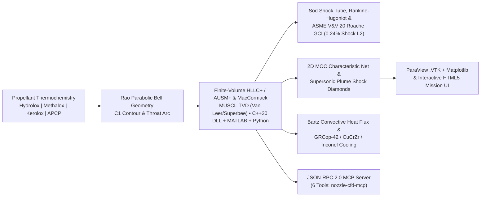

# nozzle-cfd-propulsion

[](https://github.com/perfectalone375/nozzle-cfd-propulsion/actions/workflows/ci.yml)


A production-verified **Multi-Propellant Rocket Propulsion & Supersonic Nozzle CFD Digital Twin** combining **Conservative Shock-Capturing MacCormack CFD**, **2D Method of Characteristics (MOC) Shock-Diamond Plume Physics**, **Bartz Regenerative Thermal Cooling**, **ParaView `.vtk` Mesh Export**, and **MCP Agent Tooling**—implemented and continuously cross-verified across **Python (`NumPy/SciPy`)**, **MATLAB/Octave (`.m`)**, and **C++17 (`g++ -O3`)**.

> New to CFD or rocket propulsion? Read the step-by-step **[Beginner's Guide to Rocket Propulsion & CFD](BEGINNERS_GUIDE_CFD_AND_PROPULSION.md)** included in this repository.

---

## Architecture Overview



---

## Visual Verification Results

### 1. Finite-Volume HLLC+ Riemann Solver, Sod Shock Tube & Roache GCI (Step 1)
Compares **HLLC+ / AUSM+ MUSCL-TVD (`van_leer`, `superbee`)** against 1st-Order Rusanov on Toro's exact **Sod Shock Tube** (`L1 = 0.0029` vs `0.0183`), cuts in-nozzle normal-shock $L_2$ error **10×** (`0.24%` vs MacCormack's `2.51%`), and proves mesh independence across `81 → 161 → 321` grids (**`p_obs = 2.16`**, **`GCI_fine = 0.025%`**).


### 2. Shock-Capturing MacCormack CFD & Bartz Nozzle Thermal Load
Compares smooth design supersonic expansion against an off-design overexpanded case forcing a **standing normal shock wave inside the bell**, alongside Bartz convective throat heat flux and **GRCop-42** regenerative liner wall temperature margin.


### 2. Multi-Propellant Trade Study (`Pc = 10 MPa`, `eps = 16`)
Quantitative thermochemical comparison across **LOX/LH2 (Hydrolox)**, **LOX/LCH4 (Methalox)**, **LOX/RP-1 (Kerolox)**, and **APCP Composite Solid** boosters.


### 3. 2D Axisymmetric Supersonic Nozzle & Exhaust Plume Shock Diamonds
Method-of-Characteristics (MOC) internal wave rays paired with 2D supersonic Mach-diamond cells (exported simultaneously to ParaView in [`deliverables/nozzle_plume_field.vtk`](deliverables/nozzle_plume_field.vtk)).


---

## Multi-Language Solver Parity (All Tested in GitHub CI)

| Implementation | Directory / File | Highlight | Verified By |
| :--- | :--- | :--- | :--- |
| **Python 3.10–3.12** | [`src/nozzle_cfd/`](src/nozzle_cfd/) | Finite-Volume **HLLC+ / AUSM+ MUSCL-TVD**, Sod benchmark, **ASME V&V 20 GCI**, MacCormack, Bartz cooling, `.vtk` & MCP server | `pytest` + `ruff` |
| **MATLAB / Octave** | [`matlab/`](matlab/) | [`solve_nozzle_hllc_fvm.m`](matlab/solve_nozzle_hllc_fvm.m), [`solve_nozzle_cfd_maccormack.m`](matlab/solve_nozzle_cfd_maccormack.m), [`propellant_trade_study.m`](matlab/propellant_trade_study.m), [`moc_minimum_length_nozzle.m`](matlab/moc_minimum_length_nozzle.m) | `octave --no-gui` in CI |
| **C++20 (`g++ -O3`)** | [`cpp/`](cpp/) | [`hllc_fvm_solver.cpp`](cpp/hllc_fvm_solver.cpp) (`nozzle_fvm_core.dll`/`.so` Python accelerator + CLI) & [`maccormack_cfd.cpp`](cpp/maccormack_cfd.cpp) | `g++ -O3` in CI & local |

---

## Quickstart

```bash
# Install Python package + dev tools
pip install -e ".[dev]"

# Run 1D CFD, 2D Plume, Bartz Cooling, and generate VTK + Matplotlib deliverables
nozzle-cfd --propellant METHALOX --chamber-pressure-mpa 10.0 --ambient-pressure-kpa 101.325 --export-all

# Run verification test suite
pytest tests

# Compile and run C++17 solver
make -C cpp test

# Start MCP JSON-RPC 2.0 server over stdio
nozzle-cfd-mcp
```

---

## Opening the 3D/2D Flowfield in ParaView

1. Run `nozzle-cfd --export-all` (or open pre-generated [`deliverables/nozzle_plume_field.vtk`](deliverables/nozzle_plume_field.vtk)).
2. Open **ParaView** -> **File > Open** -> `deliverables/nozzle_plume_field.vtk` -> Click **Apply**.
3. Color by **`Mach_Number`** or **`Static_Pressure_kPa`** to inspect internal supersonic expansion and exhaust Mach diamonds interactively.
