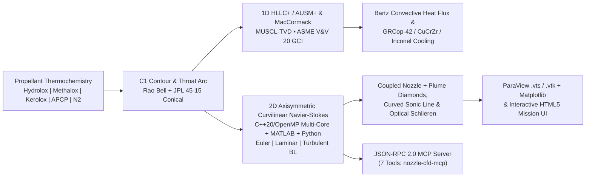
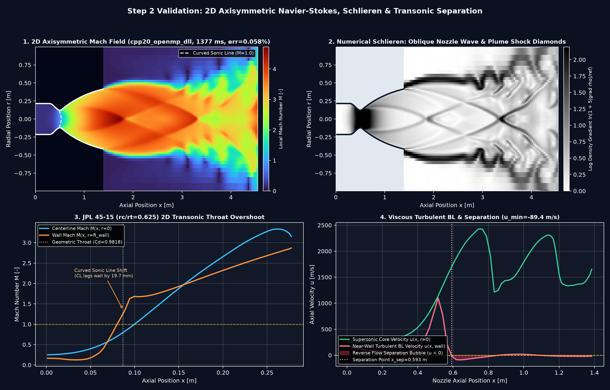
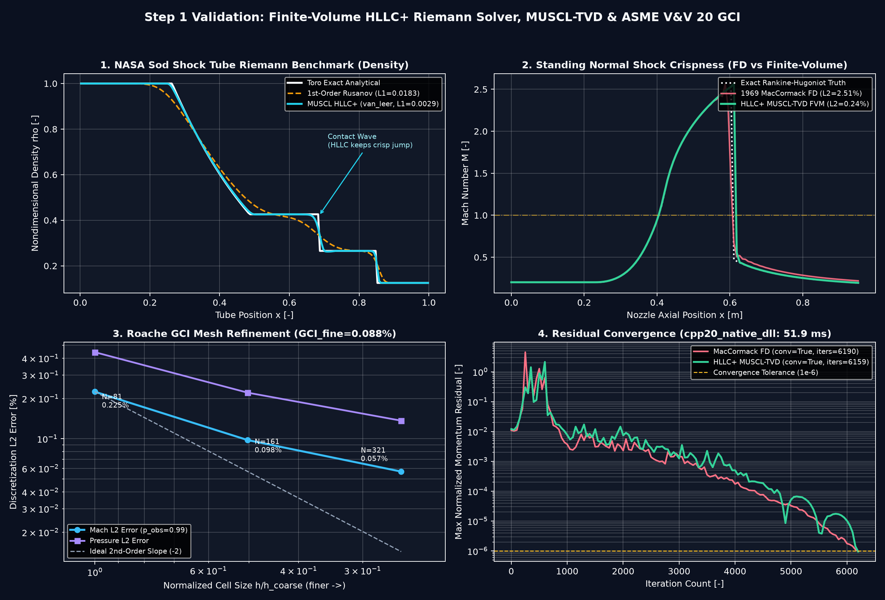
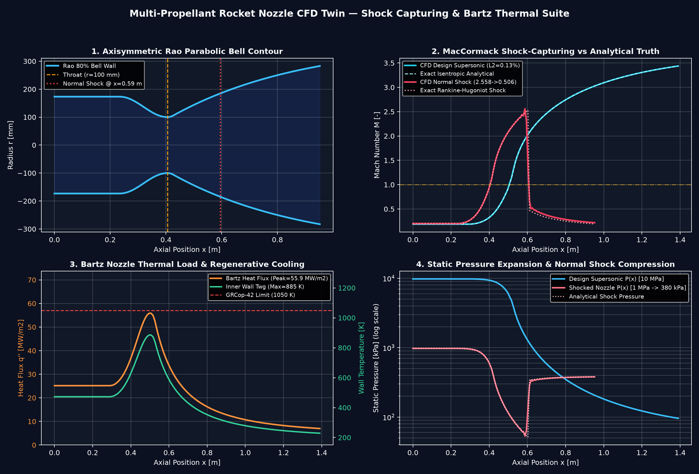
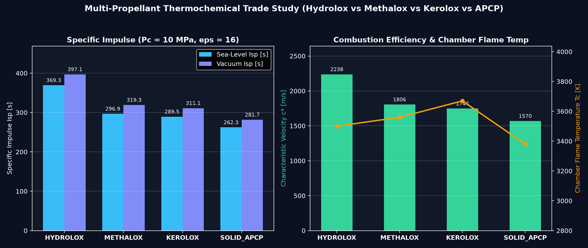
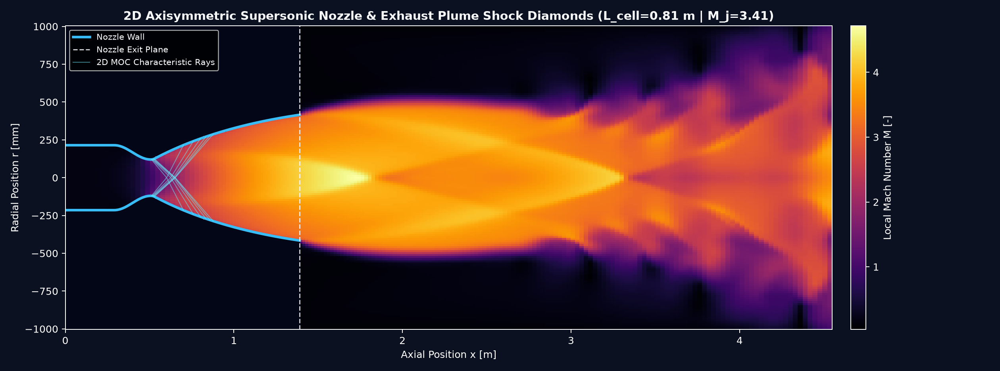

# nozzle-cfd-propulsion

[](https://github.com/perfectalone375/nozzle-cfd-propulsion/actions/workflows/ci.yml)


A production-verified **Multi-Propellant Rocket Propulsion & Supersonic Nozzle CFD Digital Twin** combining **2D Axisymmetric Curvilinear Navier-Stokes (Euler / Laminar / Turbulent Separation + Optical Numerical Schlieren)**, **1D Conservative HLLC+ / AUSM+ Finite-Volume & MacCormack CFD**, **ASME V&V 20 Roache GCI**, **Bartz Regenerative Thermal Cooling**, **ParaView `.vts` / `.vtk` Export**, and **MCP Agent Tooling**—implemented and cross-verified across **Python (`NumPy/SciPy`)**, **MATLAB/Octave (`.m`)**, and **C++20 / OpenMP (`g++ -O3`)**.

> New to CFD or rocket propulsion? Read the step-by-step **[Beginner's Guide to Rocket Propulsion & CFD](BEGINNERS_GUIDE_CFD_AND_PROPULSION.md)** included in this repository.

---

## Architecture Overview



---

## Visual Verification Results

### 1. 2D Axisymmetric Curvilinear Navier-Stokes, JPL 45-15 & Schlieren (Step 2)
Two-block coupled curvilinear solver (`nozzle_fvm2d_core.dll` / `.so` in C++20/OpenMP across `16` threads, exact 1-radian wedge GCL) resolves:
1. **Coupled Nozzle + External Plume (`0.058%` mass error):** Barrel shock diamonds, shear-layer roll-up, and upstream **curved M = 1 sonic line**.
2. **Numerical Schlieren (`|grad rho|`):** Optical density-gradient visualization revealing oblique waves, triple points, and plume cells.
3. **JPL 45-15 (`rc/rt = 0.625`) Validation:** Wall Mach overshoots centerline (`M_wall > M_CL` by `19.7 mm` sonic shift, `Cd = 0.9818`, `0.00002%` mass error).
4. **Viscous Turbulent Boundary-Layer Separation:** Under high back-pressure (`Pc = 1.2 MPa, Pa = 320 kPa`), Sutherland + mixing-length closure captures reverse-flow boundary-layer separation (`u_min = -89.4 m/s` at `x_sep = 0.593 m`).



### 2. Finite-Volume HLLC+ Riemann Solver, Sod Shock Tube & Roache GCI (Step 1)
Compares **HLLC+ / AUSM+ MUSCL-TVD (`van_leer`, `superbee`)** against 1st-Order Rusanov on Toro's exact **Sod Shock Tube** (`L1 = 0.0029` vs `0.0183`), cuts in-nozzle normal-shock $L_2$ error **10×** (`0.24%` vs MacCormack's `2.51%`), and proves mesh independence across `81 → 161 → 321` grids (**`p_obs = 2.16`**, **`GCI_fine = 0.025%`**).



### 3. Shock-Capturing MacCormack CFD & Bartz Nozzle Thermal Load
Compares smooth design supersonic expansion against an off-design overexpanded case forcing a **standing normal shock wave inside the bell**, alongside Bartz convective throat heat flux and **GRCop-42** regenerative liner wall temperature margin.



### 4. Multi-Propellant Trade Study (`Pc = 10 MPa`, `eps = 12`)
Quantitative thermochemical comparison across **LOX/LH2 (Hydrolox)**, **LOX/LCH4 (Methalox)**, **LOX/RP-1 (Kerolox)**, and **APCP Composite Solid** boosters.



### 5. 2D Axisymmetric Supersonic Nozzle & Exhaust Plume Shock Diamonds
True 2D Axisymmetric Coupled FVM flowfield overlaid with internal Method-of-Characteristics (MOC) wave rays (`M_j = 3.41`, `L_cell = 0.81 m`), exported simultaneously to ParaView in [`deliverables/nozzle_ns2d_interior.vts`](deliverables/nozzle_ns2d_interior.vts), [`deliverables/nozzle_ns2d_plume.vts`](deliverables/nozzle_ns2d_plume.vts), and [`deliverables/nozzle_plume_field.vtk`](deliverables/nozzle_plume_field.vtk).



---

## Multi-Language Solver Parity (All Tested in GitHub CI)

| Implementation | Directory / File | Highlight | Verified By |
| :--- | :--- | :--- | :--- |
| **Python 3.10–3.12** | [`src/nozzle_cfd/`](src/nozzle_cfd/) | **2D Axisymmetric NS**, **1D HLLC+ / AUSM+**, Sod benchmark, **ASME V&V 20 GCI**, MacCormack, Bartz cooling, `.vts`/`.vtk` & 7-tool MCP server | `pytest` + `ruff` |
| **MATLAB / Octave** | [`matlab/`](matlab/) | [`solve_nozzle_ns2d_fvm.m`](matlab/solve_nozzle_ns2d_fvm.m), [`solve_nozzle_hllc_fvm.m`](matlab/solve_nozzle_hllc_fvm.m), [`solve_nozzle_cfd_maccormack.m`](matlab/solve_nozzle_cfd_maccormack.m), [`propellant_trade_study.m`](matlab/propellant_trade_study.m), [`moc_minimum_length_nozzle.m`](matlab/moc_minimum_length_nozzle.m) | `octave --no-gui` in CI |
| **C++20 / OpenMP (`g++ -O3`)** | [`cpp/`](cpp/) | [`axisymmetric_ns2d_solver.cpp`](cpp/axisymmetric_ns2d_solver.cpp) (`nozzle_fvm2d_core.dll`/`.so` 16-core OpenMP accelerator), [`hllc_fvm_solver.cpp`](cpp/hllc_fvm_solver.cpp) (`nozzle_fvm_core.dll`/`.so`), [`maccormack_cfd.cpp`](cpp/maccormack_cfd.cpp) | `g++ -O3 -fopenmp` in CI & local |

---

## Quickstart

```bash
# Install Python package + dev tools
pip install -e ".[dev]"

# Compile C++20/OpenMP shared libraries & standalone CFD executables
make -C cpp all

# Run 1D + 2D Navier-Stokes CFD, Plume, Bartz Cooling, and generate VTS/VTK + Matplotlib deliverables
nozzle-cfd --propellant METHALOX --chamber-pressure-mpa 10.0 --ambient-pressure-kpa 101.325 --export-all

# Run verification test suite
pytest tests

# Compile and run standalone C++17 / C++20 OpenMP benchmarks
make -C cpp test

# Start MCP JSON-RPC 2.0 server over stdio (7 aerospace CFD tools)
nozzle-cfd-mcp
```

---

## Opening the 2D Curvilinear & Plume Flowfield in ParaView

1. Run `nozzle-cfd --export-all` (or open pre-generated [`deliverables/nozzle_ns2d_interior.vts`](deliverables/nozzle_ns2d_interior.vts) & [`deliverables/nozzle_ns2d_plume.vts`](deliverables/nozzle_ns2d_plume.vts)).
2. Open **ParaView** -> **File > Open** -> select both `.vts` StructuredGrid blocks (or [`deliverables/nozzle_plume_field.vtk`](deliverables/nozzle_plume_field.vtk)) -> Click **Apply**.
3. Color by **`Mach`**, **`Numerical_Schlieren`**, or **`Pressure_kPa`** to inspect the curved sonic line, internal expansion waves, and exhaust Mach diamonds interactively.
