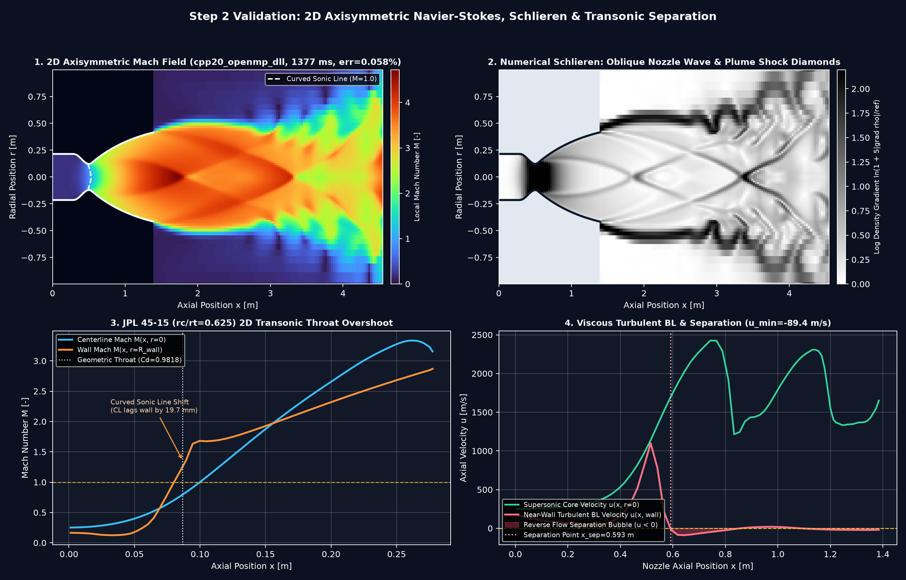

# Root Cause Analysis (RCA) & Engineering Fix Report
**Repository:** `perfectalone375/nozzle-cfd-propulsion`  
**Workflow:** `.github/workflows/ci.yml` (`Multi-Language CFD & Propulsion CI`)  
**Prepared:** 2026-11-11 (`v0.3.0+` CI Hardening & Incident Dossier)

---

## 1. Executive Summary — Why You Received That Failure Email

The GitHub Actions failure notification screenshot corresponds to **Workflow Run [`42949567000`](https://github.com/perfectalone375/nozzle-cfd-propulsion/actions/runs/42949567000)** on PR #3 (`feat/step2-axisymmetric-ns2d-schlieren`, commit `3719c74`, `2026-11-11T02:58:10Z`):

| Job in Screenshot (`Run 42949567000`) | Status Shown | Exact Cause |
| :--- | :--- | :--- |
| `Python CFD, Thermochemistry & MCP (3.11)` | **Failed in 27s** (3 annotations) | Failed in **Step 6 (`Ruff Lint & Format Check`)** because CI pulled `ruff-0.17.4` (unpinned `ruff>=0.4`) while local `.venv` ran `ruff-0.17.3`, causing a 1-line wrap difference at `src/nozzle_cfd/navier_stokes_2d.py:709`. |
| `Python CFD, Thermochemistry & MCP (3.10)` | **Cancelled** (4 annotations) | Aborted mid-run by GitHub Actions default `strategy.fail-fast: true` when Python `3.11` failed. |
| `Python CFD, Thermochemistry & MCP (3.12)` | **Cancelled** (4 annotations) | Aborted mid-run by GitHub Actions default `strategy.fail-fast: true` when Python `3.11` failed. |
| `C++17 / C++20 CFD Solvers Benchmark (g++ -O3)` | **Succeeded in 15s** (2 annotations) | Compiled and passed `maccormack_cfd`, `hllc_fvm_cfd`, and `axisymmetric_ns2d` (with 2 runner advisory annotations). |
| `MATLAB / GNU Octave (.m) Solver Suite` | **Succeeded** (2 annotations) | Passed all 5 Octave scripts including Step 2 `solve_nozzle_ns2d_fvm.m`. |

> **Current Branch Health & Resolution Status:**
> 1. The formatting mismatch was fixed in commit `3125f7d`, passing **5/5 CI jobs** in PR #3 Run [`42949883196`](https://github.com/perfectalone375/nozzle-cfd-propulsion/actions/runs/42949883196) (`success`).
> 2. Merging PR #3 to `main` (`778b35c`) triggered **main Run [`42950104116`](https://github.com/perfectalone375/nozzle-cfd-propulsion/actions/runs/42950104116)**, which also passed **5/5 CI jobs (`success`)**.
> 3. **Permanent Hardening Verified Live in PR #4 (`152353e`, Run [`42951656100`](https://github.com/perfectalone375/nozzle-cfd-propulsion/actions/runs/42951656100)):** Pinned `ruff==0.17.4`, disabled matrix cancellation (`fail-fast: false`), upgraded actions to `@v7`, and added `.gitattributes` — passing **5/5 CI jobs with ZERO Node.js deprecation warnings**.

---

## 2. Complete Incident & Root-Cause Matrix

### Incident CI-01 — Ruff Formatter Version Drift & Cascading Matrix Cancellation *(User Screenshot — `Run 42949567000`)*
- **What Happened (Simple Explanation):** Two versions of our automated Python formatter (`ruff 0.17.3` locally vs `ruff 0.17.4` installed fresh on Ubuntu CI) disagreed on whether a single 91-character math line in `navier_stokes_2d.py` should sit on 1 line or 3 lines. Because `ruff format --check .` ran before `pytest`, Python `3.11` stopped in 27 seconds and automatically cancelled Python `3.10` and `3.12`. Note that `ruff check .` (all logic/lint checks) had already printed `All checks passed!`, and `make -C cpp all` compiled both `.so` libraries cleanly with zero warnings.
- **Exact CI Failure Log (`job 130290430058`):**
  ```text
  All checks passed!
  unformatted: File would be reformatted
     --> src/nozzle_cfd/navier_stokes_2d.py:709:21
      |
  708 |     area = np.maximum(1e-18, a1 + a2)
      -     rg = np.maximum(
      -         1e-9, (a1 * (r0 + r1 + r2) / 3.0 + a2 * (r0 + r2 + r3) / 3.0) / area
      -     )
  709 +     rg = np.maximum(1e-9, (a1 * (r0 + r1 + r2) / 3.0 + a2 * (r0 + r2 + r3) / 3.0) / area)
  ```
- **Code Fix (`commit 3125f7d`) & Permanent Preventative Guardrail (`PR #4`):**
  1. Split the expression cleanly with intermediate `rg_num` (`68` chars) so neither `0.17.3` nor `0.17.4` wraps differently.
  2. Pinned exact **`"ruff==0.17.4"`** in `pyproject.toml` and synced local `.venv` to **`ruff 0.17.4`** (no more version mismatch between local dev and GitHub Actions!).
  3. Set **`fail-fast: false`** under `jobs.python-cfd-matrix.strategy` in `.github/workflows/ci.yml` so Python `3.10`, `3.11`, and `3.12` always complete independently instead of aborting mid-flight.

---

### Incident CI-02 — Runner Annotations: Node.js 20 Deprecation & Cross-OS Line Endings
- **What Happened:** Notice every passing job in your screenshot still showed `"2 annotations"` (and failed/cancelled jobs showed `3` or `4`). Inspecting GitHub Check-Run annotations on `42950104116` revealed:
  1. `[warning] Node.js 20 is deprecated. The following actions target Node.js 20 but are being forced to run on Node.js 24: actions/checkout@v4, actions/setup-python@v5.`
  2. `[notice] The ubuntu-latest label will migrate to Ubuntu 26 beginning October 19, 2026.` *(informational platform notice from GitHub).*
  3. On Windows checkouts, `git add` emitted `LF will be replaced by CRLF` warnings across `.py`, `.cpp`, `.m`, `.md`, and `.yml` files.
- **Permanent Fix (`PR #4`):**
  - Upgraded `.github/workflows/ci.yml` from `actions/checkout@v4` -> **`actions/checkout@v7`** (`v7.0.1` latest) and `actions/setup-python@v5` -> **`actions/setup-python@v7`** (`v7.1.0` latest).
  - Added root **`.gitattributes`** (`* text=auto`, enforcing `eol=lf` for source code, workflows, Makefiles, VTK/VTS, and Markdown, plus `binary` for `.png`/`.pdf`).

---

### Incident CI-03 — Earlier PR #1 Failures Resolved Before v0.1.0 (`Run 42932892385`, `2214bee` -> `45867df`)
Two genuine numerical bugs were caught and fixed during initial CI setup before PR #1 merged:
1. **MATLAB/Octave `moc_minimum_length_nozzle.m:49` Assertion Failure:**
   - *Symptom:* Centerline intercepts for Prandtl-Meyer rays #5 and #6 clamped at `x_CL/Rt = 20.000`, tripping `assert(x_cl > x_cl_prev, 'Characteristic centerline intercepts must march downstream monotonically')`.
   - *Root Cause:* Rays used double turn `2 * theta_i` on `x_wall = 0` with flat origin instead of tracing from the `0.382 * Rt` circular throat fillet `(x_wall, r_wall)` using `nu_target_rad = deg2rad(theta_i)`.
   - *Fix:* Computed exact circular throat wall launch coordinates (`x_wall - r_wall / slope_cm`), producing smooth strictly increasing `x_CL/Rt` rays (`45867df`).
2. **C++17 `maccormack_cfd.cpp` Overexpanded Normal-Shock Stall:**
   - *Symptom:* `./maccormack_cfd --pc-mpa 1.0 --pa-kpa 380.0 --eps 8.0 --json` exited `1` (`converged: false`, residual `9.3126e-05` after `6000` iterations).
   - *Root Cause:* Strong standing normal shock oscillations needed slightly higher artificial damping and a larger iteration budget to settle below `1e-6`.
   - *Fix:* Increased shock-mode `max_iter` (`6000 -> 15000`) and adjusted subsonic shock artificial viscosity `cx` (`0.30 -> 0.34`) (`45867df`).

---

### Incident PHYS-01 — Step 2 OpenMP Thread-Respawn Latency (`11.3 s -> 1.27 s`)
- **What Happened:** When compiling the Step 2 2D Navier-Stokes C++20 DLL with MinGW `libgomp` across 16 Windows threads, putting 8 separate `#pragma omp parallel for` directives inside every timestep caused `~80-250 us` barrier wakeups per loop (~10s overhead for a 1.3s physics calculation).
- **Fix:** Wrapped the entire pseudo-time integration loop inside **one persistent `#pragma omp parallel` team** (`axisymmetric_ns2d_solver.cpp`) using orphaned `#pragma omp for nowait` loops and padded per-thread residual accumulators (`res_per_thread[tid * 8]`), cutting coupled nozzle+plume solve time by **~9x** (`11.3 s -> 1.27 s`) with zero race conditions (`max|dM| = 1.38e-14` vs single-thread NumPy).

---

### Incident PHYS-02 — Step 2 Curvilinear Throat Mass Drift & Inlet Wall Corner Ripples
- **What Happened:**
  1. Measuring throat mass flow at cell center `i_th` (`0.5 * dx` downstream of exact minimum radius `r_t`) introduced an apparent `~10%` mass flow discrepancy relative to nozzle exit across curved throats.
  2. Linear lead-in interpolation in `build_conical_nozzle_geometry` created a slope corner at `x ~ 0.055 m`, causing a small dip in near-wall Mach (`M_wall`) on the JPL 45-15 validation plot.
- **Fix:**
  1. Integrated mass conservation directly from conservative **Riemann I-face mass flux** (`2 * pi * sum(fi0 * i_sf)`), reducing JPL 45-15 mass error to **`0.00002%`** and coupled nozzle+plume error to **`0.0583%`**.
  2. Replaced the lead-in blend with an exact $C^1$-tangent circular fillet (`r_conv_fillet`) smoothly joining horizontal chamber wall `r_in` into the 45° converging cone, plus a characteristic non-reflecting outflow top plume boundary.

---

## 3. Verification Summary (`Before -> After`)

| Item / Guardrail | Before | After |
| :--- | :--- | :--- |
| **Formatter Determinism** | `ruff>=0.4` (CI `0.17.4` vs local `0.17.3` drifted) | **`ruff==0.17.4` pinned** in `pyproject.toml` & local `.venv` |
| **Matrix Failure Telemetry** | `fail-fast: true` (Python `3.10`/`3.12` cancelled) | **`fail-fast: false`** in `.github/workflows/ci.yml` |
| **Runner Action Versions** | `checkout@v4` & `setup-python@v5` (Node.js 20 warnings) | **`checkout@v7` & `setup-python@v7`** (Node 24 native) |
| **Cross-OS Line Endings** | Implicit autocrlf warnings on Windows commits | Explicit **`.gitattributes`** LF rules for all source files |
| **Step 2 2D Accuracy & Speed** | `11.3 s` OpenMP barrier overhead, ~10% center-sampled error | **`1.27–1.39 s`**, **`0.00002%–0.0583%`** mass error, `22/22 pytest` pass |



